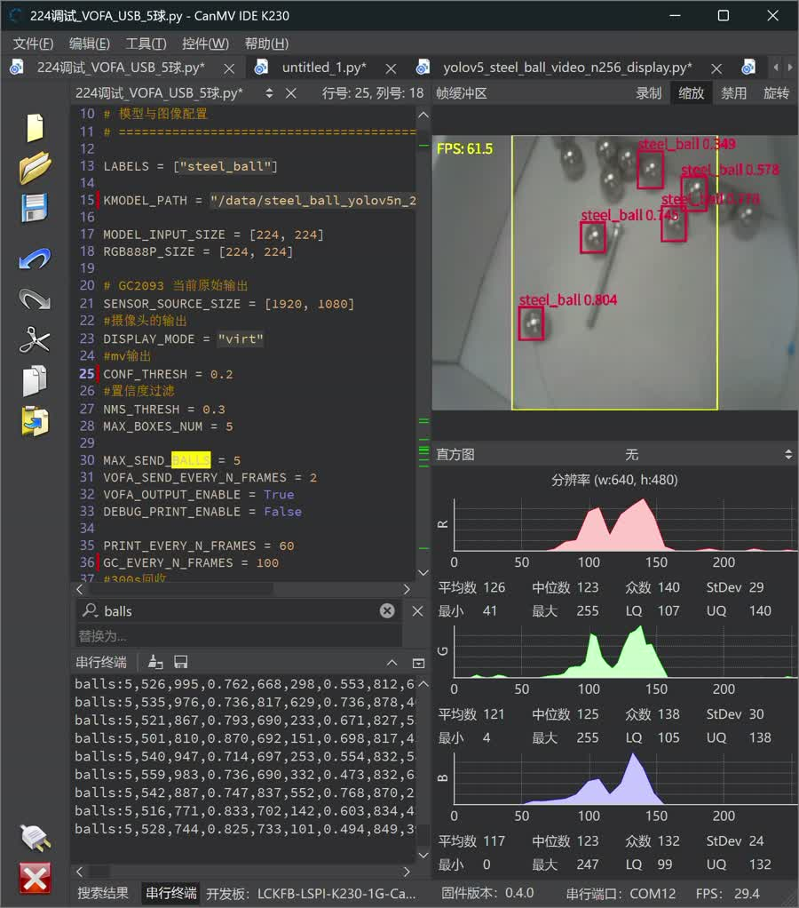
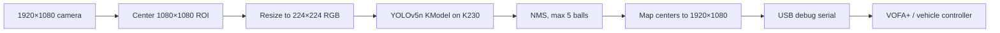
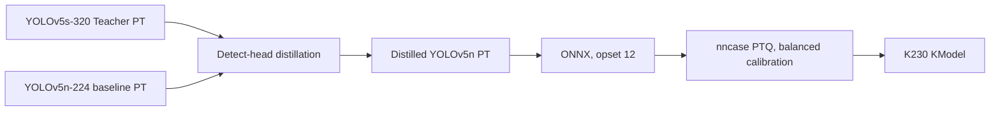

# 26电赛H满分省一技术方案分享

> GitHub 仓库 URL 使用 ASCII slug：`26-diansai-H-manfenshengyi-jishufanganfenxiang`。
> 本项目包含 SZ 嵌入式框架、小车主控架构、K230 视觉、图传和报告分享。

面向 K230 CanMV 的钢球多目标检测项目。项目从约 30 FPS 的 YOLOv5s-320 基线出发，通过中心 ROI、YOLOv5n-224、检测头知识蒸馏、平衡 PTQ 校准和统一后端评测，在板端实现约 60 FPS，并通过 USB 调试串口向 VOFA+ 输出最多 5 个钢球中心坐标。



## Highlights

- **边缘端实时性**：K230/CanMV 实机演示约 60 FPS。
- **小模型部署**：YOLOv5n，输入 `224×224`，KModel 约 2.16 MB。
- **检测头知识蒸馏**：YOLOv5s-320 Teacher 指导 YOLOv5n-224 Student。
- **量化问题定位**：发现旧校准集 50/50 均为无球负样本。
- **统一评测**：同一验证集、预处理、NMS 和指标实现比较 PT、ONNX、KModel。
- **完整通信闭环**：每帧最多 5 球，按当前帧从左到右排序，以 FireWater 文本协议发送坐标。

## 2026 电赛 H 题小车案例

本仓库的 K230/视觉部分服务于 2026 年电赛 H 题“车载平衡滚球运动控制系统”。小车主控的软件架构采用 [SZ Embedded Code Framework](https://github.com/ianhequn/sz-embedded-code-framework) 的分层方式：平台适配、驱动模型、共享数据、PID/算法和任务状态机彼此分开；本仓库负责 Orange Pi/K230 视觉、模型部署、图传和报告材料。

整机报告候选版见 [`report/H题_提交版候选.pdf`](report/H题_提交版候选.pdf)，架构映射见 [`docs/sz-framework-integration.md`](docs/sz-framework-integration.md)。

## Results

严格统一的 `224×224` 离线评测：

| Model | Precision | Recall | mAP50 | mAP50-95 | Deploy P | Deploy R | FP | FN |
|---|---:|---:|---:|---:|---:|---:|---:|---:|
| Baseline PT | 0.8104 | 0.8565 | 0.8476 | 0.3594 | 0.8276 | 0.8610 | 40 | 31 |
| Baseline KModel | 0.7666 | 0.8789 | 0.8287 | 0.3526 | 0.8190 | 0.8520 | 42 | 33 |
| Distilled PT | 0.7986 | 0.8700 | 0.8538 | 0.3740 | 0.8553 | 0.9013 | 34 | 22 |
| Distilled ONNX | 0.7986 | 0.8700 | 0.8538 | 0.3740 | 0.8553 | 0.9013 | 34 | 22 |
| **Distilled KModel** | **0.8110** | 0.8465 | **0.8520** | **0.3726** | **0.8511** | **0.8969** | **35** | **23** |

相对旧 KModel：

- mAP50：`0.8287 -> 0.8520`
- mAP50-95：`0.3526 -> 0.3726`
- 部署阈值误检：`42 -> 35`
- 部署阈值漏检：`33 -> 23`
- 多球漏检图片：`24 -> 18`

> Windows nncase Simulator 的耗时不代表 K230 板端 FPS。板端速度来自 CanMV 实机循环计时。

## System Pipeline



训练与部署模型链路：



## Why The Old KModel Lost Accuracy

PT 与 ONNX 在统一输入下几乎逐元素一致，因此 ONNX 导出不是主要问题。旧转换脚本直接从按文件名排列的训练图片中选择前 50 张：

```powershell
Get-ChildItem $datasetImages -File | Select-Object -First 50
```

这些图片恰好全部是 `negative_hard_*`，即：

```text
No-ball calibration images: 50
Positive calibration images: 0
```

量化器没有观察到钢球出现时的激活分布，导致 KModel 置信度和检测结果发生偏移。新流程使用 100 张校准图片，覆盖无球、稀有球数、多球、亮度、对比度和清晰度差异。

完整复盘见 [docs/optimization-journey.md](docs/optimization-journey.md)。

## Repository Layout

```text
.
├── assets/                  # K230 demo image
├── configs/                 # training hyperparameters and dataset example
├── docs/                    # engineering notes and experiment reasoning
├── k230/                    # CanMV deployment and VOFA+ output
├── models/                  # model download instructions
├── results/                 # real metrics, plots and reports
├── scripts/                 # parameterized PowerShell entry points
└── tools/                   # ROI, distillation, calibration, conversion, evaluation
```

## Dataset Layout

原始数据集不包含在仓库中。准备以下 YOLO 格式：

```text
datasets/steel_ball_roi_224/
├── images/
│   ├── train/
│   └── val/
├── labels/
│   ├── train/
│   └── val/
└── steel_ball.yaml
```

标签格式：

```text
class_id center_x center_y width height
```

所有坐标归一化到 `[0, 1]`。

## Reproduce

### 1. Create 224 ROI dataset

```powershell
python .\tools\create_roi_dataset.py `
  --source path\to\source_dataset `
  --output .\datasets\steel_ball_roi_224 `
  --size 224
```

### 2. Distill YOLOv5n

```powershell
.\scripts\train_distill.ps1 `
  -Python path\to\python.exe `
  -Yolov5Root path\to\yolov5 `
  -TeacherWeights path\to\yolov5s_teacher.pt `
  -StudentWeights path\to\yolov5n_baseline.pt `
  -DataYaml .\datasets\steel_ball_roi_224\steel_ball.yaml
```

### 3. Export ONNX

```powershell
.\scripts\export_onnx.ps1 `
  -Python path\to\python.exe `
  -Yolov5Root path\to\yolov5 `
  -Weights .\runs\yolov5n_224_distilled\weights\best.pt `
  -Output .\models\steel_ball_yolov5n_224_distilled.onnx
```

### 4. Build balanced calibration set

```powershell
python .\tools\create_balanced_calibration.py `
  --dataset .\datasets\steel_ball_roi_224 `
  --output .\calibration_data `
  --count 100 `
  --negative-count 20
```

### 5. Convert KModel

```powershell
.\scripts\convert_kmodel.ps1 `
  -NncasePython path\to\nncase_env\python.exe `
  -NncaseTools path\to\nncase_tools `
  -Onnx .\models\steel_ball_yolov5n_224_distilled.onnx `
  -CalibrationDir .\calibration_data `
  -Output .\models\steel_ball_yolov5n_224_roi.kmodel
```

模型文件见 [GitHub Releases](https://github.com/ianhequn/26-diansai-H-manfenshengyi-jishufanganfenxiang/releases)。

### 6. Unified PT / ONNX / KModel evaluation

```powershell
.\scripts\evaluate.ps1 `
  -Python path\to\python.exe `
  -Yolov5Root path\to\yolov5 `
  -DataYaml .\datasets\steel_ball_roi_224\steel_ball.yaml `
  -Pt .\models\steel_ball_yolov5n_224_distilled_best.pt `
  -Onnx .\models\steel_ball_yolov5n_224_distilled.onnx `
  -KModel .\models\steel_ball_yolov5n_224_roi.kmodel
```

## K230 Output Protocol

FireWater 固定发送 16 个数字：

```text
balls:count,x0,y0,score0,...,x4,y4,score4\n
```

空槽位：

```text
-1,-1,0
```

编号仅表示当前帧从左到右顺序，不是跨帧永久 ID。

## Documentation

- [今日优化复盘（中文）](docs/today-optimization-review.zh-CN.md)
- [Optimization journey](docs/optimization-journey.md)
- [Knowledge distillation](docs/knowledge-distillation.md)
- [PT to ONNX to KModel](docs/model-conversion-and-quantization.md)
- [Evaluation methodology](docs/evaluation-methodology.md)
- [K230 and VOFA+ deployment](docs/k230-deployment.md)
- [SZ 框架与 H 题小车架构](docs/sz-framework-integration.md)
- [报告来源与公开边界](docs/report-provenance.md)
- [整理包验证记录](docs/verification-2026-11-18.md)

## License

本项目包含基于 Ultralytics YOLOv5 修改的训练代码，遵循 [AGPL-3.0](LICENSE)。YOLOv5 and its original source code are copyright Ultralytics.
