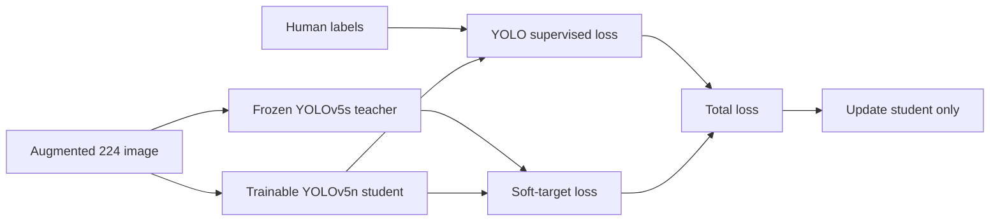

# Detection-Head Knowledge Distillation

## Teacher and Student

The teacher is a larger YOLOv5s model originally trained at `320×320`. The deployed student is YOLOv5n at `224×224`.

The teacher is used only during training. It is frozen and discarded after training, so it adds no K230 inference cost.

```text
Ground-truth labels: tell the student what is correct.
Teacher outputs: tell the student how a stronger model distributes confidence.
```

## Why Both Models Receive 224×224

YOLOv5 is fully convolutional, so the teacher PT checkpoint can run at 224. At that input size, teacher and student have compatible Detect grids:

```text
P3: [B, 3, 28, 28, 6]
P4: [B, 3, 14, 14, 6]
P5: [B, 3,  7,  7, 6]
```

The flattened prediction contains 3087 candidates:

```text
28×28×3 + 14×14×3 + 7×7×3 = 3087
```

For one class, each candidate has:

```text
x, y, w, h, objectness, steel_ball_score
```

Using teacher input 320 would produce incompatible `40×40`, `20×20`, and `10×10` grids and require an additional alignment method.

## Training Flow



Teacher execution:

```python
teacher.eval()
for parameter in teacher.parameters():
    parameter.requires_grad_(False)

with torch.no_grad():
    teacher_prediction = teacher(images)
```

## Loss

```text
L_total = L_YOLO + lambda(t) * L_KD
```

The implementation uses:

```text
L_KD = L_objectness + 0.5 * L_box + 0.25 * L_class
```

- Objectness uses soft BCE targets over detection positions.
- Box regression uses Smooth L1 and is weighted by teacher objectness.
- Class loss uses soft BCE targets. With one class, objectness and box transfer matter most.

The final settings were:

```text
temperature = 2.0
object threshold = 0.02
maximum KD weight = 0.04
KD warmup = 5 epochs
```

Temperature softens extreme logits, exposing relative confidence differences that are absent from hard labels.

## Failed First Attempt

The first smoke test used `kd_weight=0.15`. The teacher term dominated the supervised term:

```text
Approximate supervised batch loss: 0.85
Weighted KD contribution:          1.26
```

Validation accuracy fell. The weight was reduced to `0.04`, and a five-epoch ramp was added.

This is an important constraint: the teacher is not ground truth. Distillation should guide the student, not override human labels.

## Distillation vs Pseudo-Labels

Pseudo-labeling converts teacher detections into hard YOLO labels. This project instead compares teacher and student Detect tensors during training.

```text
Pseudo-labeling: teacher boxes become additional annotations.
Distillation: teacher probabilities and regression outputs become soft loss targets.
```

## Why The KModel Cannot Be The Teacher

KModel is a compiled inference artifact. Distillation needs raw training tensors, PyTorch autograd, and backpropagation. The teacher must therefore be the trusted `.pt` checkpoint.

```text
Teacher PT -> student training -> student PT -> ONNX -> KModel
```

